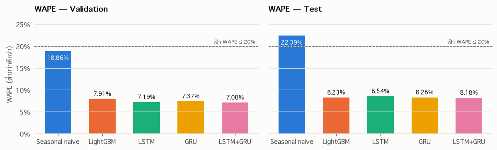
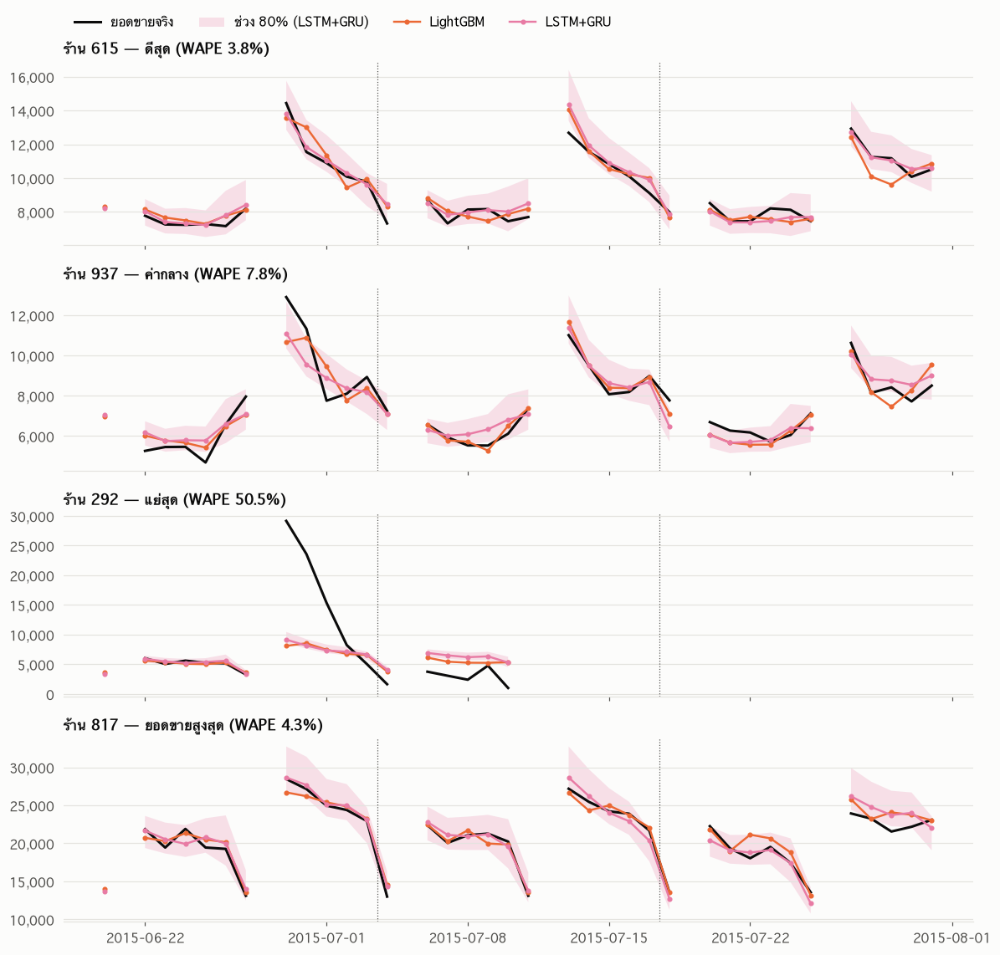
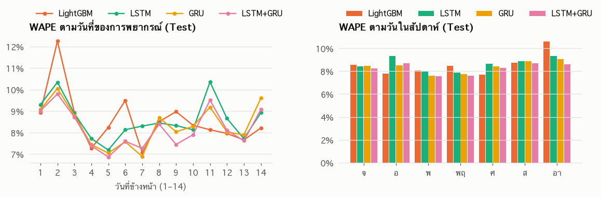
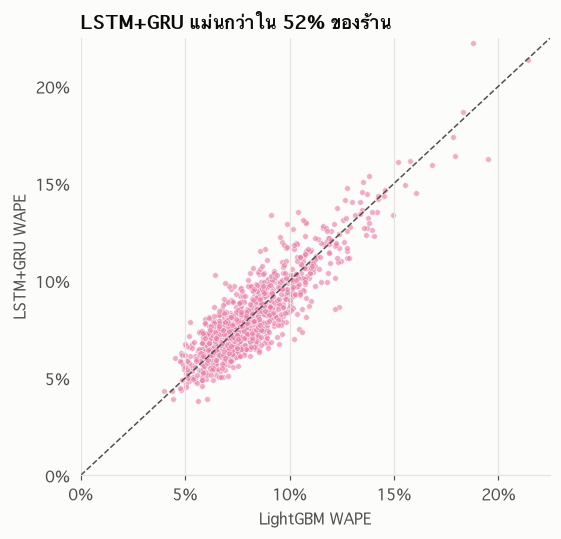
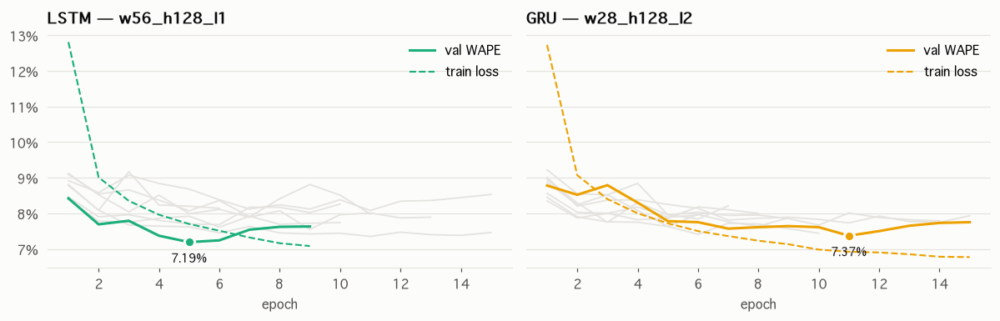
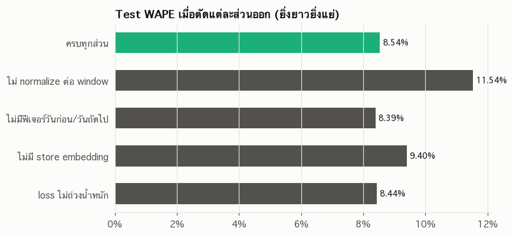
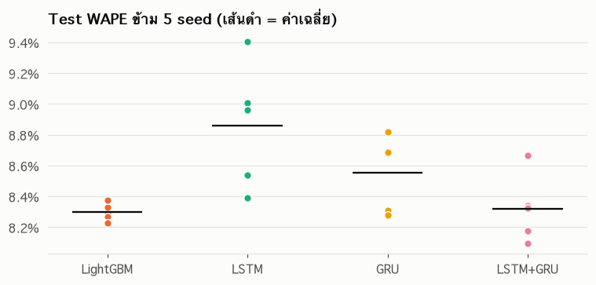
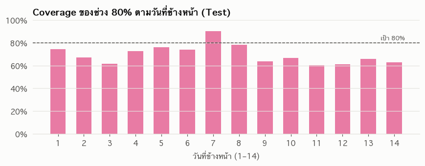
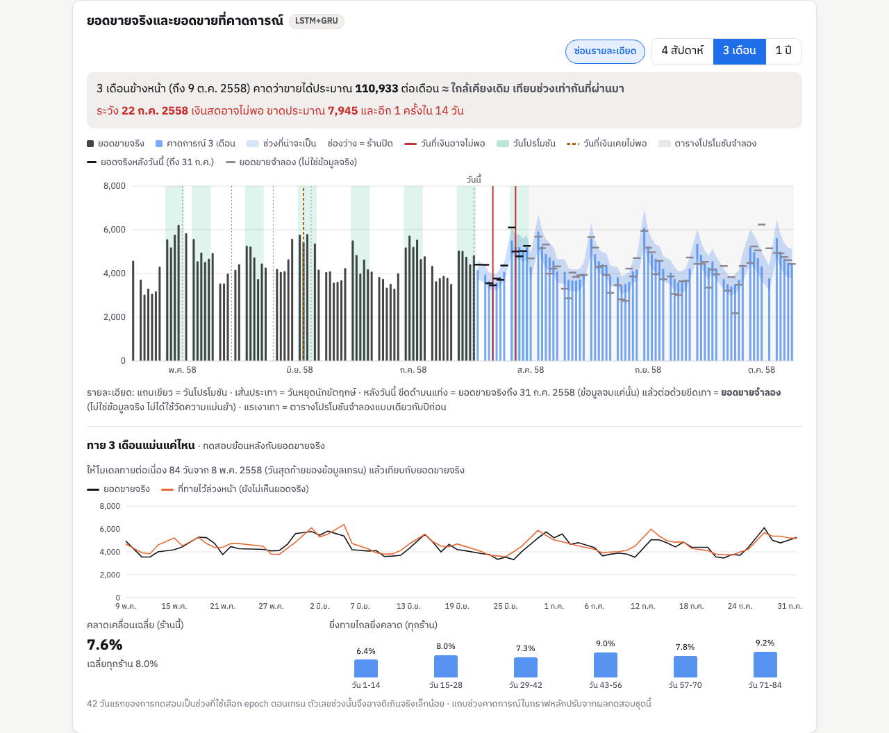
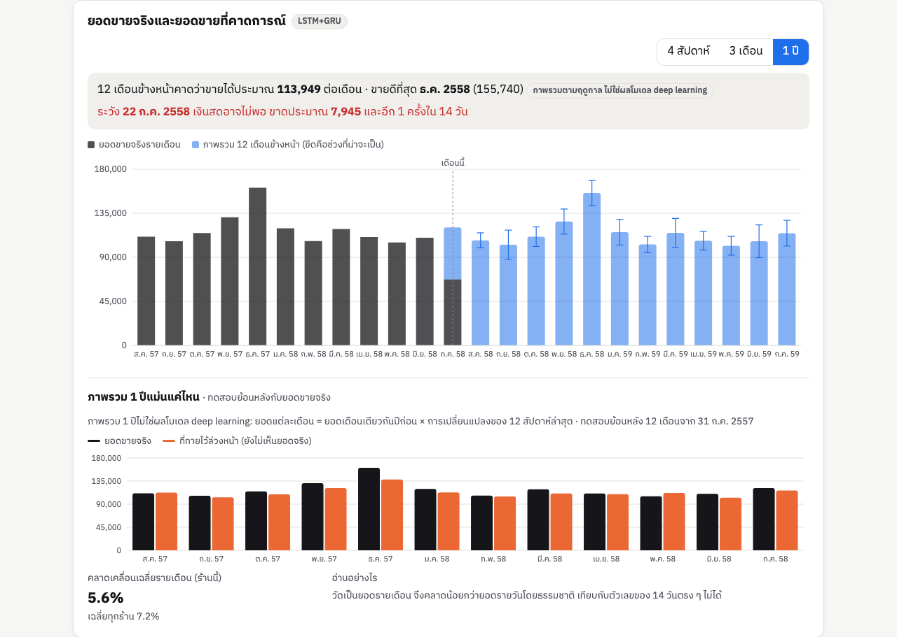

# รายงานส่วนที่ 1: การพยากรณ์ยอดขายรายวันด้วย LSTM/GRU

**โครงงาน:** MFP — Merchant Financial Passport
**ส่วนงาน:** Workstream 1 — Cash-Flow Forecasting (ส่วนที่ใช้ประเมินในรายวิชา Deep Learning)

---

## สารบัญ

1. [บทนำและวัตถุประสงค์](#1-บทนำและวัตถุประสงค์)
2. [ข้อมูล](#2-ข้อมูล)
3. [การกำหนดปัญหาและการประเมินผล](#3-การกำหนดปัญหาและการประเมินผล)
4. [โมเดล](#4-โมเดล)
5. [การพัฒนาโมเดลและการปรับจูน](#5-การพัฒนาโมเดลและการปรับจูน)
6. [ผลการทดลอง](#6-ผลการทดลอง)
7. [การวิเคราะห์เพิ่มเติม](#7-การวิเคราะห์เพิ่มเติม)
8. [การนำไปใช้ในระบบ](#8-การนำไปใช้ในระบบ)
9. [ข้อจำกัดและงานในอนาคต](#9-ข้อจำกัดและงานในอนาคต)
10. [สรุป](#10-สรุป)
11. [ภาคผนวก: การทำซ้ำผลการทดลอง](#ภาคผนวก-การทำซ้ำผลการทดลอง)

---

## 1. บทนำและวัตถุประสงค์

ร้านค้าขนาดเล็กจำนวนมากมีรายได้สม่ำเสมอ แต่ไม่มีเครื่องมือที่ช่วยมองล่วงหน้าว่าเงินสดจะพอจ่ายค่าใช้จ่ายที่กำลังจะถึงหรือไม่ MFP จึงพยากรณ์ยอดขายรายวันของร้านค้าล่วงหน้า 14 วัน แล้วนำผลไปคำนวณช่วงที่เงินสดอาจขาด (cash-flow gap) และสัญญาณสุขภาพทางการเงินที่อธิบายได้

รายงานส่วนนี้ครอบคลุมเฉพาะโมเดลพยากรณ์ยอดขาย ซึ่งเป็นส่วน deep learning ของโครงงาน

**วัตถุประสงค์**

1. สร้างโมเดล LSTM และ GRU แบบ global (โมเดลเดียวใช้กับทุกร้าน) พยากรณ์ยอดขายรายวันล่วงหน้า 14 วัน
2. ได้ค่า **WAPE ≤ 20%** บนชุดทดสอบ และ**ดีกว่า baseline ทั้งสองตัว** (seasonal naive และ LightGBM)
3. ส่งออกผลพยากรณ์ในรูปแบบที่แอปพลิเคชันนำไปใช้ได้ทันที โดยไม่ต้องรันโมเดลสดระหว่างสาธิต

---

## 2. ข้อมูล

### 2.1 ชุดข้อมูลหลัก: Rossmann Store Sales

ข้อมูลยอดขายรายวันของร้านขายยา Rossmann ในเยอรมนี จากการแข่งขันบน Kaggle

| รายการ | ค่า |
| --- | --- |
| จำนวนร้าน | 1,115 ร้าน |
| จำนวนแถว | 1,017,209 แถว |
| ช่วงเวลา | 2013-01-01 ถึง 2015-07-31 (942 วัน) |
| ไฟล์ที่ใช้ | `train.csv` (ยอดขายรายวัน), `store.csv` (ข้อมูลร้าน) |

> **หมายเหตุ:** Rossmann ใช้เป็นตัวแทนของ "ร้านค้า" เพื่อพัฒนาและประเมินวิธีการเท่านั้น ไม่ใช่ข้อมูลร้านค้ารายย่อยในประเทศไทย

### 2.2 การทำความสะอาดข้อมูล

| ประเด็นที่พบ | จำนวน | วิธีจัดการ |
| --- | --- | --- |
| วันที่ร้านปิด (`Open = 0`) ยอดขายเป็น 0 | — | เก็บไว้พร้อมฟีเจอร์ `open` แต่ไม่นับใน loss และ metric |
| ร้านหายไปจากข้อมูลช่วง 2014-07-01 ถึง 2014-12-31 | 180 ร้าน × 184 วัน | เติมวันให้ครบปฏิทิน ติด flag `is_missing` และข้าม training window ที่ทับวันเหล่านี้ |
| ร้าน 988 หายไป 1 วัน (2013-01-01) | 1 วัน | จัดการแบบเดียวกัน |
| ร้านเปิดแต่ยอดขายเป็น 0 | 54 แถว จาก 41 ร้าน (ไม่มีในช่วง Test) | เก็บไว้แต่ติด flag และไม่นับใน loss และ metric |
| คอลัมน์ `Customers` | — | ตัดทิ้ง เพราะไม่รู้ล่วงหน้า ณ เวลาพยากรณ์ |

วันที่หายไปทั้งหมดอยู่ในช่วง Train ส่วนช่วง Validation และ Test มีข้อมูลครบทุกร้าน

### 2.3 การแบ่งข้อมูล

แบ่งตามเวลาเท่านั้น ไม่สุ่ม เพื่อป้องกันการใช้ข้อมูลอนาคตทำนายอดีต

| ชุด | ช่วงวันที่ | จำนวนวัน | store-day ที่ใช้ประเมิน |
| --- | --- | --- | --- |
| Train | 2013-01-01 ถึง 2015-05-08 | 858 | 766,584 |
| Validation | 2015-05-09 ถึง 2015-06-19 | 42 | 37,472 |
| Test | 2015-06-20 ถึง 2015-07-31 | 42 | 40,282 |

ทุกโมเดลใช้การแบ่งข้อมูลเดียวกันและ random seed เดียวกัน (42)

### 2.4 ฟีเจอร์

| กลุ่ม | ฟีเจอร์ |
| --- | --- |
| ปฏิทิน | วันในสัปดาห์, วันที่ของเดือน, เดือน, สัปดาห์ของปี |
| รู้ล่วงหน้า | `open`, `promo`, `school_holiday`, `state_holiday` (a/b/c) |
| ร้าน | `store_type`, `assortment`, `log(competition_distance)` + store embedding |
| ประวัติยอดขาย | input window 28 หรือ 56 วัน (LSTM/GRU); lag ≥ 14 วัน (LightGBM) |

**การปรับสเกลยอดขาย:** หารยอดขายด้วยค่าเฉลี่ยของแต่ละร้าน (คำนวณจากช่วง Train เท่านั้น) เพื่อให้ร้านเล็กและร้านใหญ่ เทรนร่วมกันได้ ค่าเฉลี่ยรายร้านอยู่ระหว่าง 2,708 ถึง 21,820 ยูโรต่อวัน

---

## 3. การกำหนดปัญหาและการประเมินผล

### 3.1 รูปแบบการพยากรณ์

ทุกโมเดลพยากรณ์**ทีละ 14 วัน** จาก "จุดตั้งต้น" (origin) ที่ใช้ยอดขายจริงได้ถึงวันนั้น ช่วง Validation และ Test ยาว 42 วัน จึงมี 3 จุดตั้งต้นต่อช่วง (rolling origin)

```
Validation: origin 2015-05-08 → พยากรณ์ 05-09..05-22
            origin 2015-05-22 → พยากรณ์ 05-23..06-05
            origin 2015-06-05 → พยากรณ์ 06-06..06-19
Test:       origin 2015-06-19, 07-03, 07-17 (แบบเดียวกัน)
```

ณ จุดตั้งต้น โมเดลรู้ฟีเจอร์ที่รู้ล่วงหน้าของ 14 วันข้างหน้า เช่น วันเปิดร้าน โปรโมชัน และวันหยุด แต่ไม่รู้ยอดขายจริงในช่วงนั้น

### 3.2 ตัวชี้วัด

วัดเฉพาะวันที่ร้านเปิดและมีข้อมูลครบ (`is_eval_day = 1`)

```
WAPE = Σ|y − ŷ| / Σ|y|
```

- **WAPE** เป็นตัวชี้วัดหลัก เทียบเป็นสัดส่วนของยอดขายรวม ร้านใหญ่และร้านเล็กเปรียบเทียบกันได้
- รายงาน **MAE** และ **RMSE** ประกอบ (หน่วยยูโรต่อวัน)
- ไม่ใช้ MAPE เพราะหารด้วยศูนย์ในวันที่ยอดขายเป็น 0

---

## 4. โมเดล

### 4.1 Baseline

| โมเดล | วิธีการ |
| --- | --- |
| **Seasonal naive** | ยอดขายวันเดียวกันของสัปดาห์ก่อน ถ้าวันนั้นร้านปิด ใช้วันเดียวกันที่เปิดล่าสุดก่อนจุดตั้งต้น |
| **LightGBM** | ตารางฟีเจอร์ + lag 14/21/28/35/42 วัน, ค่าเฉลี่ยและส่วนเบี่ยงเบนแบบ rolling (เลื่อน 14 วัน), โปรโมชันและวันหยุดของวันก่อน/วันถัดไป; target เป็น `log1p(sales)`; early stopping บน val WAPE (หยุดที่ 208 รอบ) |

LightGBM ใช้ lag ≥ 14 วันเท่านั้น เพื่อให้ทุกวันในช่วงพยากรณ์ 14 วันใช้ข้อมูลที่เกิดก่อนหรือ ณ จุดตั้งต้นเท่านั้น

### 4.2 สถาปัตยกรรม LSTM / GRU

โมเดลเดียวใช้ร่วมกันทุกร้าน (global model) LSTM และ GRU ใช้สถาปัตยกรรมเดียวกัน ต่างกันแค่ชนิดของ recurrent cell

```
Input ย้อนหลัง (W วัน × 25 ฟีเจอร์) ──► LSTM/GRU (1–2 ชั้น, hidden H) ──┐
Store ID ──► Embedding (16 มิติ) ─────────────────────────────────────────┼─► Dense(H, ReLU) ─► context
ข้อมูลร้าน + log(ระดับยอดขาย) ───────────────────────────────────────────┘
                                                                              │
ฟีเจอร์รู้ล่วงหน้าของแต่ละวัน (14 วัน × 24 ฟีเจอร์) ──► [context ต่อกับแต่ละวัน]
                                                    ──► Dense(64, ReLU) ──► Dense(1)   (ใช้ร่วมทุกวัน)
                                                    ──► ยอดขาย 14 วัน (multi-output)
```

**องค์ประกอบสำคัญ**

1. **Normalize ต่อ window:** หารยอดขายทั้ง input และ target ด้วย "ระดับยอดขาย" คือค่าเฉลี่ยของวันที่เปิดใน input window นั้น โมเดลจึงพยากรณ์ **สัดส่วนเทียบกับยอดขายช่วงหลัง** แทนค่าสัมบูรณ์ และรับ `log(ระดับ)` เป็นฟีเจอร์เพิ่ม
2. **ฟีเจอร์ของวันก่อนและวันถัดไป:** ให้แต่ละวันในช่วงพยากรณ์เห็นสถานะเปิดร้าน โปรโมชัน และวันหยุดของวันข้างเคียงด้วย เพราะยอดขายมักพุ่งก่อนหรือหลังวันปิดร้าน
3. **Store embedding:** เวกเตอร์ 16 มิติแทนลักษณะเฉพาะของแต่ละร้าน
4. **Output head ที่ใช้ร่วมทุกวัน:** ทั้ง 14 วันใช้ Dense ชุดเดียวกัน แต่ละวันได้ฟีเจอร์รู้ล่วงหน้าของตัวเอง
5. **Loss ที่ตรงกับ WAPE:** ใช้ absolute error ถ่วงน้ำหนักด้วยระดับยอดขาย และนับเฉพาะวันที่ประเมิน การลด loss จึงเท่ากับลด WAPE โดยตรง

```
loss = Σ w·|y_rel − ŷ_rel| / Σ w ,   w = is_eval_day × ระดับยอดขาย (หน่วยยูโร)
```

### 4.3 การเทรน

| การตั้งค่า | ค่า |
| --- | --- |
| Training windows | 834,194 ชุด (window 56) / 870,454 ชุด (window 28) |
| สุ่มต่อ epoch | 200,000 windows, batch 512 |
| Optimizer | Adam, learning rate 1e-3, ลดครึ่งเมื่อ val WAPE ไม่ดีขึ้น 2 epoch |
| Early stopping | ตาม val WAPE, patience 4, คืนน้ำหนักของ epoch ที่ดีที่สุด, สูงสุด 30 epoch |
| Dropout | 0.2 |
| Seed | 42 |

### 4.4 Ensemble

ค่าเฉลี่ยของ LSTM และ GRU ที่ดีที่สุด น้ำหนักเท่ากัน ไม่ได้ fit พารามิเตอร์เพิ่ม

**กติกาที่ตั้งไว้ก่อนดูผล Test:** ใช้ ensemble เป็นโมเดลหลักก็ต่อเมื่อ val WAPE ดีกว่าโมเดลเดี่ยวที่ดีที่สุด ผลคือ val WAPE ได้ 7.08% เทียบกับ LSTM 7.19% จึงใช้ ensemble

---

## 5. การพัฒนาโมเดลและการปรับจูน

### 5.1 ปัญหาที่พบระหว่างพัฒนา

LSTM ผ่านการปรับมา 3 รอบก่อนได้สถาปัตยกรรมสุดท้าย (hidden 64, 1 ชั้น, window 56)

| รอบ | สิ่งที่เปลี่ยน | val WAPE | test WAPE |
| --- | --- | --- | --- |
| 1 | สถาปัตยกรรมพื้นฐาน | 11.36% | 11.30% |
| 2 | + ฟีเจอร์วันก่อน/วันถัดไป | 10.47% | 11.52% |
| 3 | + normalize ต่อ window | **7.68%** | **8.83%** |

**รอบ 1 → 2:** error กระจุกในวันก่อนหรือหลังวันหยุดและวันปิดร้าน (สูงถึง 17–21% ขณะที่วันอื่น 8–11%) เพราะ output head มองทีละวัน ไม่รู้ว่าวันข้างเคียงเป็นวันหยุด จึงเพิ่มฟีเจอร์วันข้างเคียง

**รอบ 2 → 3:** เมื่อวัด error แยกตามช่วงเวลา พบว่า bias ของโมเดลเลื่อนจาก +1% ถึง +3% ในปี 2014 เป็น −4% ถึง −7% ในช่วง Validation/Test ปี 2015 ยอดขายช่วงนั้นโตขึ้น แต่โมเดลยึดระดับยอดขายเฉลี่ยของช่วง Train ไว้ (จดจำผ่าน store embedding) แทนที่จะตามระดับล่าสุดใน input การ normalize ต่อ window แก้ปัญหานี้ และกลายเป็นองค์ประกอบที่สำคัญที่สุด (ยืนยันด้วย ablation ในหัวข้อ 7.2)

### 5.2 การปรับจูน hyperparameter

ทำ grid search ตามงบที่กำหนด แยกสำหรับ LSTM และ GRU รวม 16 config **เลือกจาก val WAPE เท่านั้น** ระหว่างปรับจูนไม่มีการคำนวณหรือบันทึกผล Test

| Window | Hidden | ชั้น | LSTM val WAPE | GRU val WAPE |
| --- | --- | --- | --- | --- |
| 28 | 64 | 1 | 8.08% | 7.73% |
| 28 | 64 | 2 | 7.55% | 7.67% |
| 28 | 128 | 1 | 8.08% | 7.41% |
| 28 | 128 | 2 | 7.90% | **7.37%** ✓ |
| 56 | 64 | 1 | 7.68% | 7.82% |
| 56 | 64 | 2 | 7.35% | 7.75% |
| 56 | 128 | 1 | **7.19%** ✓ | 7.63% |
| 56 | 128 | 2 | 7.61% | 7.87% |

**Config ที่เลือก:** LSTM window 56 / hidden 128 / 1 ชั้น และ GRU window 28 / hidden 128 / 2 ชั้น

LSTM ทำได้ดีกว่าเมื่อใช้ window 56 ส่วน GRU กลับดีกว่าเมื่อใช้ window 28 และโมเดลใหญ่สุด (hidden 128 + 2 ชั้น) ไม่ได้ดีที่สุดใน LSTM ซึ่งน่าจะเกิดจาก overfitting

---

## 6. ผลการทดลอง

### 6.1 ผลหลัก (ช่วง Test, seed 42)

| โมเดล | WAPE | MAE | RMSE |
| --- | --- | --- | --- |
| Seasonal naive | 22.39% | 1,563 | 2,206 |
| LightGBM | 8.23% | 574 | **855** |
| LSTM | 8.54% | 596 | 894 |
| GRU | 8.28% | 578 | 867 |
| **LSTM+GRU (โมเดลหลัก)** | **8.18%** | **571** | 862 |

ช่วง Validation: seasonal naive 18.86%, LightGBM 7.91%, LSTM 7.19%, GRU 7.37%, LSTM+GRU 7.08%



**เทียบกับเป้าหมาย**

| เป้าหมาย | ผล |
| --- | --- |
| WAPE ≤ 20% | ✅ ผ่าน (8.18%) |
| ดีกว่า seasonal naive | ✅ ผ่าน (error ต่ำกว่าเกือบ 3 เท่า) |
| ดีกว่า LightGBM | ✅ ผ่านใน WAPE และ MAE แต่ส่วนต่างน้อยมาก (0.05 จุด) และ RMSE ยังแย่กว่า และเมื่อทดสอบหลาย seed (หัวข้อ 7.3) พบว่าไม่ได้ดีกว่าอย่างสม่ำเสมอ |

### 6.2 ตัวอย่างการพยากรณ์รายร้าน



กราฟแสดง 4 ร้าน ได้แก่ ร้านที่โมเดลพยากรณ์ดีที่สุด ค่ากลาง แย่ที่สุด และร้านที่ยอดขายสูงสุด เส้นประแนวตั้งคือจุดตั้งต้นแต่ละรอบ แถบสีจางคือช่วงคาดการณ์ (หัวข้อ 7.5)

- โมเดลจับรูปแบบรายสัปดาห์ ผลของโปรโมชัน และการเปิด/ปิดร้านได้ดี
- **ร้าน 292 (WAPE 50.5%)** ยอดขายพุ่งเกือบ 30,000 ยูโรหลังร้านปิดไปหลายวัน น่าจะเป็นการเปิดร้านใหม่หลังปรับปรุง ทั้ง LSTM+GRU และ LightGBM พลาดเหมือนกัน เพราะไม่มีฟีเจอร์ใดบอกเหตุการณ์นี้ล่วงหน้า

### 6.3 Error แยกตามระยะพยากรณ์และวันในสัปดาห์



- error ไม่ได้เพิ่มขึ้นตามระยะพยากรณ์อย่างชัดเจน เพราะยอดขายขึ้นกับฟีเจอร์ที่รู้ล่วงหน้า (โปรโมชัน, วันหยุด) มากกว่าระยะเวลา
- error สูงในบางวันที่ตรงกับช่วงวันหยุดในช่วง Test

### 6.4 เปรียบเทียบรายร้าน



LSTM+GRU แม่นกว่า LightGBM ใน **52% ของร้าน** จุดกระจายรอบเส้นทแยง สอดคล้องกับข้อสรุปว่าทั้งสองโมเดลทัดเทียมกัน

---

## 7. การวิเคราะห์เพิ่มเติม

### 7.1 Learning curves



train loss ลดลงต่อเนื่อง แต่ val WAPE หยุดดีขึ้นที่ประมาณ epoch 5 (LSTM) และ epoch 11 (GRU) แสดงว่าโมเดลเริ่ม **overfit** และ early stopping เลือกจุดที่เหมาะสม ใน LSTM ช่วงท้าย train loss ต่ำกว่า val WAPE ชัดเจน

### 7.2 Ablation study

ตัดองค์ประกอบของ LSTM (config หลัก, seed 42) ออกทีละอย่าง

| แบบ | val WAPE | test WAPE | test เปลี่ยน |
| --- | --- | --- | --- |
| โมเดลเต็ม | 7.19% | 8.54% | — |
| ไม่ normalize ต่อ window | 10.65% | 11.54% | **+3.00 จุด** |
| ไม่มี store embedding | 8.44% | 9.40% | **+0.86 จุด** |
| ไม่มีฟีเจอร์วันก่อน/วันถัดไป | 7.69% | 8.39% | −0.15 จุด |
| Loss ไม่ถ่วงน้ำหนัก | 7.39% | 8.44% | −0.10 จุด |



- **Normalize ต่อ window สำคัญที่สุด** ตัดออกแล้ว error เพิ่ม 3 จุด ยืนยันข้อค้นพบในหัวข้อ 5.1
- **Store embedding ช่วยทั้ง val และ test** โมเดลต้องเรียนรู้รูปแบบเฉพาะของแต่ละร้าน
- **ฟีเจอร์วันข้างเคียงและ loss ถ่วงน้ำหนัก** ช่วยบน val แต่บน test ส่วนต่าง (±0.10–0.15 จุด) เล็กกว่าความผันผวนข้าม seed ของ LSTM (SD 0.40 จุด) จึงสรุปไม่ได้ว่ามีผล เราคงสององค์ประกอบนี้ไว้ เพราะการตัดออกตามผล Test เท่ากับใช้ Test เลือกโมเดล

### 7.3 ความเสถียรข้าม random seed

เทรน LightGBM, LSTM และ GRU ใหม่ด้วย seed 1–4 (seed 42 คือผลหลัก)

| Seed | LightGBM | LSTM | GRU | LSTM+GRU |
| --- | --- | --- | --- | --- |
| 42 | 8.23% | 8.54% | 8.28% | 8.18% |
| 1 | 8.29% | 8.39% | 8.82% | 8.34% |
| 2 | 8.33% | 9.01% | 8.69% | 8.67% |
| 3 | 8.27% | 8.96% | 8.31% | 8.33% |
| 4 | 8.38% | 9.40% | 8.69% | 8.09% |
| **ค่าเฉลี่ย ± SD** | **8.30% ± 0.06** | 8.86% ± 0.40 | 8.56% ± 0.25 | **8.32% ± 0.22** |



- LSTM+GRU ชนะ LightGBM **2 จาก 5 seed** ค่าเฉลี่ยต่างกันเพียง 0.02 จุด ซึ่งอยู่ในช่วงความผันผวน
- LightGBM เสถียรกว่ามาก (SD 0.06 จุด เทียบกับ 0.22–0.40 จุดของ RNN)
- Ensemble ลดทั้ง error และความแกว่งเมื่อเทียบกับ LSTM หรือ GRU เดี่ยว เพราะทั้งสองโมเดลพลาดคนละทิศทาง เช่น seed 4 ที่ LSTM แย่ที่สุด (9.40%) แต่ ensemble ดีที่สุด (8.09%)

**ข้อสรุป:** ผล seed 42 ที่ ensemble ชนะ LightGBM 0.05 จุด ไม่ใช่ความต่างที่มีนัยสำคัญ ข้อสรุปที่ถูกต้องคือ **LSTM+GRU ทัดเทียม LightGBM**

### 7.4 การทดสอบกับข้อมูลชุดอื่น: Favorita

นำวิธีเดิมไปใช้กับ Favorita Store Sales (ซูเปอร์มาร์เก็ตในเอกวาดอร์ 54 สาขา, 2013–2017) โดย**ใช้ config ที่เลือกจาก Rossmann ไม่ปรับจูนใหม่** รวมยอดขาย 33 หมวดสินค้าเป็นยอดรายสาขารายวัน และแบ่งข้อมูลแบบเดียวกัน (42 วันสุดท้ายเป็น Test, 42 วันก่อนหน้าเป็น Validation)

| โมเดล | val WAPE | test WAPE | test MAE | test RMSE |
| --- | --- | --- | --- | --- |
| Seasonal naive | 15.16% | 14.98% | 2,324 | 3,448 |
| LightGBM | 8.54% | **8.59%** | **1,332** | **2,002** |
| LSTM | 8.06% | 9.13% | 1,416 | 2,100 |
| GRU | 7.80% | 9.48% | 1,471 | 2,223 |
| LSTM+GRU | **7.72%** | 9.11% | 1,413 | 2,125 |

- วิธีการใช้ได้กับร้านค้าปลีกอีกประเภท ทุกโมเดลผ่าน WAPE ≤ 20% และดีกว่า seasonal naive มาก
- บน Favorita, LightGBM ชนะบน Test ชัดกว่า (0.5 จุด)
- **รูปแบบเดียวกันเกิดทั้งสองชุดข้อมูล:** LSTM/GRU ดีกว่า LightGBM บน Validation แต่ไม่ดีกว่าบน Test เพราะ Validation ถูกใช้ทำ early stopping (และเลือก config บน Rossmann) ผล Validation ของ RNN จึงดีเกินจริง ส่วน LightGBM มีผล Validation กับ Test ใกล้กันกว่า
- Favorita มีข้อมูลน้อยกว่ามาก (ประมาณ 68,000 windows เทียบกับ 834,000 ของ Rossmann) deep learning จึงมีข้อมูลเรียนรู้น้อยกว่า

### 7.5 ช่วงคาดการณ์ (prediction interval)

สร้างช่วง 80% แบบ **split-conformal**: ใช้ error สัมพัทธ์ `(จริง − พยากรณ์) / พยากรณ์` ของช่วง Validation หาเปอร์เซ็นไทล์ที่ 10 และ 90 แยกตามวันที่ข้างหน้า (1–14) แล้วนำไปใช้กับช่วง Test

| | ค่า |
| --- | --- |
| Coverage ที่ตั้งไว้ | 80% |
| **Coverage จริงบน Test** | **70.3%** |
| ความกว้างเฉลี่ย | 22.4% ของค่าพยากรณ์ (ประมาณ ±11%) |



ช่วงที่ได้**แคบเกินจริง** เพราะ Validation ถูกใช้เลือกโมเดลแล้ว error บน Validation จึงต่ำกว่าที่เกิดจริงกับข้อมูลใหม่ ผู้จัดทำ**ไม่ได้ขยายช่วงให้ได้ 80% บน Test** เพราะจะเป็นการใช้ Test ในการ calibrate ในแอปพลิเคชันจึงแสดงช่วงนี้เป็น "ช่วงคาดการณ์โดยประมาณ"

### 7.6 การพยากรณ์ระยะยาว (3 เดือน และ 1 ปี)

หน้า dashboard ให้เลือกดูได้ 3 ระยะ แต่ละระยะใช้วิธีของตัวเอง และทดสอบย้อนหลังกับยอดขายจริง

| ระยะ | วิธี | ทดสอบย้อนหลัง | WAPE ทุกร้าน |
| --- | --- | --- | --- |
| 14 วัน | LSTM+GRU (โมเดลหลัก) | ช่วง Test 42 วัน | 8.18% |
| 3 เดือน | LSTM+GRU ตัวเดิม **ทายต่อเนื่อง** ทีละ 14 วัน ใช้ค่าที่ทายเป็น input ของรอบถัดไป (ไม่เทรนใหม่) | 84 วันจาก 2015-05-08 | 7.98% |
| 1 ปี | **ภาพรวมตามฤดูกาล** (ไม่ใช่ deep learning): ยอดเดือนเดียวกันปีก่อน × การเปลี่ยนแปลงของ 12 สัปดาห์ล่าสุดเทียบปีก่อน | 12 เดือนจาก 2014-07-31 (11,208 ร้าน-เดือน) | 7.20% (รายเดือน) |

**3 เดือน — error ตามระยะ (ทุกร้าน)**

| วัน 1-14 | วัน 15-28 | วัน 29-42 | วัน 43-56 | วัน 57-70 | วัน 71-84 |
| --- | --- | --- | --- | --- | --- |
| 6.45% | 8.01% | 7.29% | 8.99% | 7.77% | 9.25% |

- error เพิ่มขึ้นตามระยะตามที่คาด แต่ยังต่ำกว่า 10% ตลอด 84 วัน
- **ข้อควรระวัง:** 42 วันแรกของ backtest ทับกับช่วง Validation ที่ใช้ทำ early stopping ตัวเลขช่วงนั้นจึงอาจดีเกินจริงเล็กน้อย
  42 วันหลังตรงกับช่วง Test ที่โมเดลไม่เคยเห็น (8.99%, 7.77%, 9.25%)
- การทายไปข้างหน้าหลังวันที่ 31 ก.ค. 2558 ไม่มีข้อมูลโปรโมชันและวันเปิดร้านจริง จึงใช้**ตารางจำลอง**:
  เปิดร้านและโปรโมชันตามวันเดียวกันในสัปดาห์ของ 52 สัปดาห์ก่อน วันหยุดตามวันที่เดียวกันของปีก่อน (ติดป้ายบนกราฟ)
- **ไม่ได้ใช้ยอดขายจำลองเทรนหรือวัดผล** เพราะจะวัดได้แค่ว่าโมเดลจำสูตรที่ใช้สร้างข้อมูลได้ ไม่ได้พิสูจน์การทายยอดขายจริง
  บน dashboard มีเส้น "ยอดขายจำลอง" หลัง 31 ก.ค. 2558 (ยอดวันเดียวกันปีก่อน × แนวโน้ม × สุ่ม, ถึง ก.ค. 2561)
  เพื่อให้เห็นภาพต่อเนื่องเท่านั้น ติดป้ายว่าไม่ใช่ข้อมูลจริง และไม่ได้มาจากโมเดล

**1 ปี**

- WAPE รายเดือนต่ำกว่ารายวันโดยธรรมชาติ เพราะความคลาดเคลื่อนรายวันหักล้างกันในยอดรวมทั้งเดือน **จึงเทียบกับตัวเลข 14 วันตรง ๆ ไม่ได้**
- ร้านที่ข้อมูลปีก่อนไม่ครบ (180 ร้านที่หายไปช่วง ก.ค.–ธ.ค. 2557) ไม่มีภาพรวม — มี 935 ร้านที่มีครบ 12 เดือน

**ช่วงคาดการณ์ของทั้งสองวิธี:** ใช้เปอร์เซ็นไทล์ที่ 80 ของ error สัมพัทธ์แบบค่าสัมบูรณ์ในแต่ละระยะของ backtest
(แถบสมมาตร ค่ากลางอยู่ในแถบเสมอ) ปรับจาก backtest ชุดเดียวกับที่ใช้วัด coverage จึงได้ 80% ตามนิยาม ไม่ใช่การพิสูจน์

```bash
python -m ai.cashflow_forecast.long_range
```

### 7.7 ข้อมูลจริงกับข้อมูลจำลองบน dashboard

โครงงานมีข้อมูลจำลองหลายส่วน เพื่อให้ระบบทำงานครบสำหรับการสาธิต ตารางนี้แยกว่าแต่ละส่วนเป็นข้อมูลจริงหรือจำลอง
และ**ส่วนไหนใช้วัดความแม่นยำของโมเดล** หลักที่ใช้คือ ตัวเลขความแม่นยำทุกตัวในรายงานนี้วัดกับ**ยอดขายจริงของ Rossmann เท่านั้น**

| ข้อมูล | จริง / จำลอง | ที่มา | ใช้วัดความแม่นยำ | การแสดงผล |
| --- | --- | --- | --- | --- |
| ยอดขายรายวัน 1 ม.ค. 2556 – 31 ก.ค. 2558 | **จริง** | Rossmann Store Sales (Kaggle) | ใช่ | เส้นดำ "ยอดขายจริง" |
| วันโปรโมชัน วันเปิดร้าน วันหยุด ถึง 31 ก.ค. 2558 | **จริง** | Rossmann | — (เป็น input) | แถบเขียว / เส้นประเทา |
| ค่าพยากรณ์ 14 วัน, 3 เดือน, ภาพรวม 1 ปี | ผลของระบบ | LSTM+GRU / ทายต่อเนื่อง / ตามฤดูกาล | ทดสอบกับยอดจริง (หัวข้อ 6, 7.6) | เส้นประสีฟ้า + แถบช่วง |
| วันโปรโมชันและวันเปิดร้านหลัง 31 ก.ค. 2558 | **จำลอง** | วันเดียวกันในสัปดาห์ของ 52 สัปดาห์ก่อน; วันหยุดตามวันที่ของปีก่อน | ไม่ใช่ | แรเงาเทา "ตารางโปรโมชันจำลอง" |
| **ยอดขายหลัง 31 ก.ค. 2558 ถึง 31 ก.ค. 2561** | **จำลอง** | ยอดจริงวันเดียวกันในสัปดาห์จากปีสุดท้ายที่มีข้อมูล × แนวโน้ม 12 สัปดาห์ของร้าน (จำกัด ±10% ต่อปี) × สุ่ม (lognormal σ = 0.08), seed 42 | **ไม่ใช่** | ขีดสีเทา "ยอดขายจำลอง (ไม่ใช่ข้อมูลจริง)" บนแท่งคาดการณ์ (เปิดในโหมดรายละเอียด) |
| รายจ่าย บิล supplier ค่าเช่า เงินเดือน และการถอนเงินของเจ้าของร้าน | **จำลอง** | Workstream 2 (`data/synthetic/README.md`) | ไม่ใช่ | ป้าย "ข้อมูลจำลอง" |
| ยอดเงินคงเหลือ และวันที่เงินเคย/อาจไม่พอ | คำนวณจากยอดขาย (จริง/พยากรณ์) − รายจ่ายจำลอง | Workstream 2 | ไม่ใช่ | ป้าย "ข้อมูลจำลอง" |

**เหตุผลที่สร้างยอดขายจำลองหลัง 31 ก.ค. 2558**

ข้อมูล Rossmann สิ้นสุดวันที่ 31 ก.ค. 2558 แต่ dashboard พยากรณ์ไปถึง ต.ค. 2558 (3 เดือน) และ ก.ค. 2559 (1 ปี)
จึงสร้างยอดขายจำลองต่อไปอีก 3 ปี เพื่อให้กราฟแสดงภาพต่อเนื่องเท่านั้น โดยมีข้อกำหนดดังนี้

1. **ไม่ใช้วัดความแม่นยำ ไม่ใช้เทรน และไม่ใช้ใน backtest** เพราะถ้าวัดโมเดลกับข้อมูลที่เราสร้างเอง จะพิสูจน์ได้แค่ว่าโมเดลจำสูตรที่ใช้สร้างข้อมูลได้
   ไม่ได้พิสูจน์ว่าทายยอดขายจริงได้
2. **สร้างแยกจากโมเดล LSTM/GRU** (อิงยอดขายจริงปีก่อน ไม่ได้อิงผลของโมเดล)
3. **ไม่ใช้คำนวณยอดเงินคงเหลือหรือการแจ้งเตือน** และไม่ส่งให้ AI Copilot
4. **แสดงแยกจากยอดขายจริงชัดเจน:** ขีดสีเทา ซ่อนไว้ในโหมดรายละเอียด และ legend กับ tooltip เขียนว่า "ยอดขายจำลอง (ไม่ใช่ข้อมูลจริง)"

**ข้อควรระวังในการอ่านกราฟ:** เส้นยอดขายจำลองกับเส้นภาพรวม 1 ปีอิงยอดขายปีก่อนเหมือนกัน จึงดูใกล้กันโดยธรรมชาติ
การที่สองเส้นนี้ใกล้กัน**ไม่ได้แปลว่าโมเดลแม่น** ความแม่นยำที่พิสูจน์ได้คือเส้นสีส้ม (ทดสอบย้อนหลัง) เทียบกับเส้นดำ (ยอดจริง)





ทำซ้ำได้ด้วย `python -m ai.cashflow_forecast.long_range` (เขียน `models/forecasts/synthetic_sales.parquet`) ปรับระยะได้ที่ค่า `SYNTHETIC_END`

---

## 8. การนำไปใช้ในระบบ

ระบบไม่รันโมเดลสดระหว่างสาธิต ผลพยากรณ์ของทุกร้านในช่วง Test ถูกคำนวณไว้ล่วงหน้าแล้วส่งออกเป็น `models/forecasts/ensemble.json` ตาม data contract ที่ทีมตกลงกัน backend โหลดไฟล์นี้ตอนเริ่มระบบ

```json
{
  "merchant_id": 1,
  "model": "ensemble-v1",
  "horizon_days": 14,
  "points": [
    {"date": "2015-06-20", "forecast": 4388.1, "lower": 3890.08, "upper": 5005.14, "actual": 4097.0}
  ],
  "metrics": {"wape": 0.0643, "mae": 282.41, "rmse": 359.45}
}
```

ผลพยากรณ์นี้เป็น input ของส่วน Cash-Flow Gap Detection (Workstream 2) ซึ่งจำลองยอดเงินคงเหลือรายวัน `B_t = B_{t-1} + Ŝ_t − E_t` เพื่อเตือนวันที่เงินสดอาจไม่พอ

---

## 9. ข้อจำกัดและงานในอนาคต

### 9.1 ข้อจำกัด

1. **ไม่ได้ดีกว่า LightGBM อย่างสม่ำเสมอ:** ทัดเทียมกัน แต่ deep learning แกว่งตาม random seed มากกว่า
2. **ผล Validation ของ RNN ดีเกินจริง:** เพราะใช้ทั้ง early stopping และเลือก config ทำให้คาดการณ์ผลบนข้อมูลใหม่สูงเกินไป และทำให้ช่วงคาดการณ์แคบเกินจริง (coverage 70% แทน 80%)
3. **เหตุการณ์ผิดปกติ:** เช่นการเปิดร้านใหม่หลังปรับปรุง ไม่มีฟีเจอร์บอกล่วงหน้า โมเดลจึงพลาดมาก
4. **ไม่มียอดขายจริงหลัง 31 ก.ค. 2558:** การพยากรณ์ 3 เดือนและ 1 ปีไปข้างหน้าจึงตรวจกับของจริงไม่ได้ ความแม่นที่รายงานมาจาก backtest เท่านั้น และเส้นยอดขายหลังวันนั้นบน dashboard เป็นข้อมูลจำลอง (หัวข้อ 7.7)
5. **ข้อมูลไม่ใช่ร้านค้ารายย่อยไทย:** Rossmann และ Favorita เป็นร้านค้าปลีกขนาดใหญ่ในยุโรปและอเมริกาใต้ ผลอาจต่างออกไปกับร้านค้าขนาดเล็ก
6. **ใช้กับร้านที่ไม่เคยเห็นตอนเทรนได้ไม่ตรงนัก:** โมเดลพึ่ง store embedding และค่าเฉลี่ยยอดขายจากช่วง Train ซึ่งร้านใหม่ไม่มี ดูหัวข้อ 9.2

### 9.2 แนวทางรองรับร้านค้าใหม่ (ยังไม่ได้ทำ)

ถ้าจะใช้กับข้อมูลจากร้านค้าที่ไม่อยู่ในชุดเทรน เช่นร้านที่อัปโหลดไฟล์ CSV เข้ามา มีแนวทางดังนี้

| แนวทาง | วิธีการ | ข้อดี / ข้อเสีย |
| --- | --- | --- |
| **Cold-start** (แนะนำ) | แทน store embedding ด้วยค่าเฉลี่ยของทุกร้าน ใช้ค่าเฉลี่ยยอดขายจากประวัติของร้านเอง ส่วนข้อมูลร้านที่ไม่มีใส่ค่ากลาง | ไม่ต้องเทรนใหม่ และใช้ได้เพราะโมเดลพยากรณ์สัดส่วนเทียบกับระดับยอดขายล่าสุด (ไม่ขึ้นกับขนาดร้านหรือสกุลเงิน) แต่คาดว่าแม่นน้อยลง (ablation: ไม่มี embedding แล้ว error เพิ่มประมาณ 0.9 จุด) |
| Fine-tune | เทรนต่อด้วยข้อมูลร้านใหม่ | แม่นกว่า แต่ต้องเทรนเพิ่มและต้องมีข้อมูลมากพอ |

**ข้อมูลขั้นต่ำที่ร้านใหม่ต้องมี:** ยอดขายรายวันอย่างน้อย 56 วัน (ควรมีประมาณ 1 ปี) และถ้าเป็นไปได้ ข้อมูลวันปิดร้านกับโปรโมชันใน 14 วันข้างหน้า ถ้าข้อมูลเป็นรายการขายรายบิล (เช่น UCI Online Retail) ต้องรวมเป็นยอดรายวันก่อน

**การตรวจสอบที่เสนอ:** ให้โมเดลที่เทรนด้วย Rossmann พยากรณ์ 54 สาขาของ Favorita แบบ cold-start โดยไม่เทรนใหม่ จะได้ตัวเลขจริงว่าร้านที่ไม่เคยเห็นคลาดเท่าใด

### 9.3 งานในอนาคตอื่น ๆ

- **ช่วงคาดการณ์ที่แม่นขึ้น:** เทรน quantile regression (pinball loss) ให้โมเดลพยากรณ์เปอร์เซ็นไทล์ได้เอง หรือแยกข้อมูลสำหรับ calibrate ออกจากข้อมูลที่ใช้เลือกโมเดล
- **ลดความแกว่งข้าม seed:** ใช้ ensemble ข้ามหลาย seed หรือเพิ่ม regularization
- **ลองสถาปัตยกรรมอื่น:** เช่น Temporal Fusion Transformer หรือ N-BEATS

---

## 10. สรุป

โครงงานส่วนนี้พัฒนาโมเดล LSTM และ GRU แบบ global สำหรับพยากรณ์ยอดขายรายวันล่วงหน้า 14 วันของร้านค้า 1,115 ร้าน โดยมีองค์ประกอบหลักคือการ normalize ต่อ window, store embedding และ loss ที่ตรงกับ WAPE

- โมเดลหลัก (ค่าเฉลี่ยของ LSTM และ GRU) ได้ **test WAPE 8.18%** ผ่านเป้าหมาย WAPE ≤ 20% อย่างมาก และ error ต่ำกว่า seasonal naive เกือบ 3 เท่า
- เมื่อเทียบกับ LightGBM ซึ่งเป็น baseline ที่แข็งมาก ผลหลักดีกว่าเล็กน้อย แต่การทดสอบ 5 seed แสดงว่า **ทั้งสองทัดเทียมกัน** (8.32% ± 0.22 เทียบกับ 8.30% ± 0.06) และ deep learning แกว่งตาม seed มากกว่า
- Ablation แสดงว่าการ normalize ต่อ window คือองค์ประกอบที่สำคัญที่สุด (+3.0 จุดเมื่อตัดออก) รองลงมาคือ store embedding (+0.86 จุด)
- วิธีการใช้ได้กับร้านค้าปลีกอีกชุดหนึ่ง (Favorita, test WAPE 9.11%) โดยไม่ต้องปรับจูนใหม่
- ผลพยากรณ์พร้อมช่วงคาดการณ์ถูกส่งออกตาม data contract และพร้อมใช้ในส่วนตรวจจับช่วงเงินสดขาดของแอปพลิเคชัน
- ขยายเป็นมุมมอง 3 เดือน (ทายต่อเนื่อง, backtest WAPE 8.0%) และ 1 ปี (ภาพรวมตามฤดูกาล ไม่ใช่ deep learning, WAPE รายเดือน 7.2%) โดยทั้งสองทดสอบย้อนหลังกับยอดขายจริง

---

## ภาคผนวก: การทำซ้ำผลการทดลอง

**สภาพแวดล้อม:** Python 3.11, TensorFlow 2.18, LightGBM 4.7 (`ai/requirements.txt`) บน macOS ต้องติดตั้ง `libomp` (`brew install libomp`)

```bash
# ข้อมูล (ต้องยอมรับกติกาการแข่งขันบน Kaggle ก่อน)
kaggle competitions download -c rossmann-store-sales -p data/raw/rossmann
python -m ai.cashflow_forecast.preprocess

# โมเดล
python -m ai.cashflow_forecast.train --model seasonal_naive
python -m ai.cashflow_forecast.train --model lightgbm
python -m ai.cashflow_forecast.train --model all --tune      # grid search LSTM + GRU
python -m ai.cashflow_forecast.train --model ensemble
python -m ai.cashflow_forecast.evaluate                       # → models/results.csv
python -m ai.cashflow_forecast.predict --model ensemble       # → models/forecasts/ensemble.json

# การวิเคราะห์เพิ่มเติม
python -m ai.cashflow_forecast.experiments curves
python -m ai.cashflow_forecast.experiments ablation
python -m ai.cashflow_forecast.experiments seeds
python -m ai.cashflow_forecast.long_range                     # 3 เดือน + 1 ปี พร้อม backtest
python -m ai.cashflow_forecast.favorita                       # แล้วรัน train/evaluate ด้วย --dataset favorita
```

**ไฟล์ที่เกี่ยวข้อง**

| ไฟล์ | เนื้อหา |
| --- | --- |
| `ai/cashflow_forecast/` | โค้ด preprocess, train, evaluate, predict, experiments, favorita |
| `models/results.csv` | ตารางผลหลัก |
| `models/tuning_lstm.csv`, `models/tuning_gru.csv` | ผลการปรับจูน |
| `models/experiments/*.csv` | learning curves, ablation, seeds |
| `models/favorita/results.csv` | ผล Favorita |
| `notebooks/forecast_results.ipynb` | กราฟทั้งหมด |
| `docs/ws1_data_decisions.md`, `docs/ws1_experiments.md`, `docs/ws1_favorita.md` | บันทึกรายละเอียดแต่ละส่วน (ภาษาอังกฤษ) |
| `tests/` | unit tests (9 ข้อ) |
